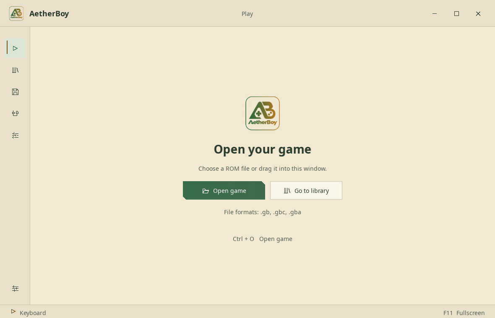
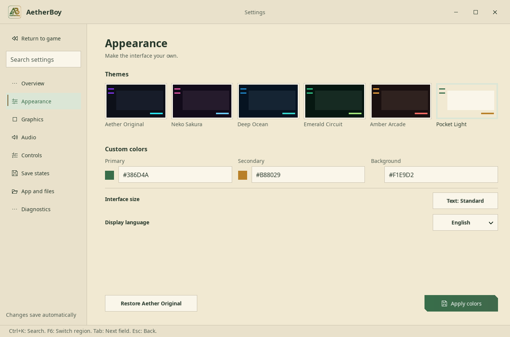
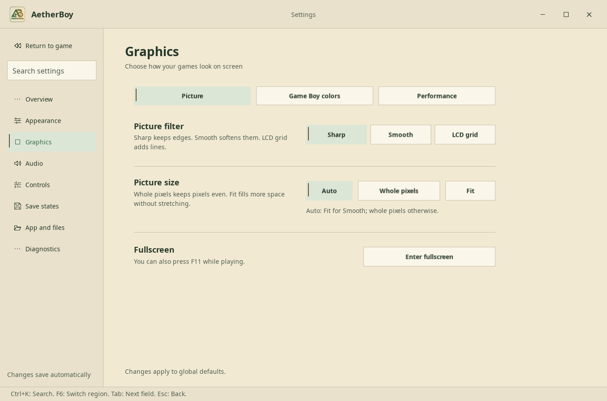

<p align="center">
  
</p>

# AetherBoy

AetherBoy is an open-source **Game Boy and Game Boy Color emulator with experimental
Game Boy Advance support**, written in C# for Windows and native Linux/Wayland.
It combines a game library, keyboard and controller input, protected saves, rewind
and developer diagnostics in a customizable desktop interface.

[](.github/workflows/ci.yml)
[](Directory.Build.props)
[](global.json)
[](LICENSE)

**English** · [Deutsch](README_DE.md)

[Get started](#getting-started) · [Tests](#development-and-testing) ·
[Documentation](#documentation-and-help) · [Contribute](CONTRIBUTING.md)

> [!IMPORTANT]
> AetherBoy is alpha software. GBA and link functionality remain experimental;
> a successful boot or connection does not prove game compatibility or a successful
> Pokémon trade. ROMs, BIOS images and e-Reader firmware/cards are not bundled.

## Features

- **Library and controls:** open `.gb`, `.gbc` and `.gba` files, import games from
  ZIP/7z archives, organize favorites and use remappable keyboard/gamepad controls
  or controller-oriented sofa mode.
- **Save protection:** atomic battery-save writes, integrity checks, three rotating
  backups, five save-state slots, a state gallery and rewind.
- **Video and audio:** aspect-correct scaling, Sharp, Smooth and LCD grid filters, Game
  Boy palettes and stereo sound. Capture screenshots, WAV audio or single-game AVI
  video with audio.
- **Player tools:** IPS/BPS/UPS patching creates separate ROM files; shared session
  cheat decoders cover documented GB/GBC and GBA formats. See the
  [cheat support matrix](docs/CHEAT_SUPPORT.md) for limits.
- **Personalization:** six themes, custom colors, per-game settings and
  English/German display-language selection, plus optional Discord activity.
- **Portable storage:** keep application data beside the executable with
  `--portable` or an `aetherboy.portable` marker file.
- **Development tools:** headless conformance checks, synthetic hardware
  regressions, audio/core inspectors and local diagnostic reports.

Both frontends share the emulation runtime. Windows uses WinForms with custom
Aether controls, NAudio and Direct2D; Linux uses SDL3 with native Wayland. See
[platform parity](docs/PLATFORM_PARITY.md) for implemented tools and outstanding
platform-specific validation.



Native Linux/Wayland interface captured from the current source, with no game loaded.

<details>
<summary>View appearance and graphics settings</summary>





</details>

## Getting started

### Prerequisites

- **Git** and **.NET SDK 10.0.302**, or a later patch in the `10.0.3xx` feature band.
  [global.json](global.json) defines the accepted SDK; check yours with
  `dotnet --version` from the repository directory.
- **Windows:** Windows 10 version 2004 (build 19041) or newer, including Windows 11.
- **Linux:** x86-64 or ARM64, glibc **2.38+**, a native Wayland session and working
  graphics drivers. X11/XWayland and musl-based distributions are not supported by
  the supplied Linux builds.
- **Linux build tools:** CMake, a C/C++ toolchain, Make and OpenSSL development
  files. The build script downloads and builds a pinned `libdatachannel` revision.
  On Ubuntu 24.04, install these with:

  ```bash
  sudo apt-get update
  sudo apt-get install cmake build-essential libssl-dev
  ```

- **Linux runtime libraries:** standard .NET dependencies (including ICU and
  OpenSSL), Wayland client libraries and PipeWire, PulseAudio or ALSA for sound.
  File selection needs an XDG Desktop Portal with a file chooser backend. See the
  [Wayland setup guide](docs/LINUX_WAYLAND.md) and
  [distribution requirements](docs/LINUX_DISTRIBUTION.md#host-requirements-and-limits).

SDL3 and UI assets are supplied by the project. Initial builds need network access
for NuGet packages and, on Linux, native dependency sources. Node.js 24 is used
for the optional room service and network/browser tests; Python 3 is used by
repository checks and packaging scripts.

### Get the source

```bash
git clone --branch development https://github.com/VoltexModz/AetherBoy.git
cd AetherBoy
```

Run the commands below from this directory. The historical `nanoboy` project and
solution names are still used in build paths.

### Linux build

```bash
bash scripts/build-linux.sh
bash scripts/run-linux.sh
```

The build selects `linux-x64` or `linux-arm64` and publishes to
`artifacts/AetherBoy-<runtime>/`, for example `artifacts/AetherBoy-linux-x64/`.
It requires the installed .NET 10 runtime, which is included with the SDK.
`run-linux.sh` rebuilds when the output is missing or older than the source.

Open a game directly:

```bash
bash scripts/run-linux.sh "/path/to/game.gbc"
```

To install the built application for the current user, including a menu entry:

```bash
bash scripts/install-linux-user.sh
aetherboy "/path/to/game.gbc"
```

Ensure `~/.local/bin` is on `PATH` for the `aetherboy` command. Installation defaults
to `~/.local/share/aetherboy/program` and does not need root. See the
[Linux user guide](docs/LINUX_USER_GUIDE.md) for controls and desktop setup.

### Windows build

Run in PowerShell on Windows:

```powershell
dotnet restore ./nanoboy.sln --locked-mode --configfile ./NuGet.config
dotnet build ./nanoboy.sln -c Release --no-restore
dotnet run --project ./nanoboy/nanoboy.csproj -c Release --no-build
```

To open a game at startup:

```powershell
dotnet run --project ./nanoboy/nanoboy.csproj -c Release --no-build -- "C:\Games\game.gbc"
```

### First use

1. Choose **Open game** or drag a ROM into the window. ZIP/7z archives with several
   games present a game selector.
2. Configure keyboard/controller bindings and audio in **Settings**. Search for
   **language** to select English, German or System, then restart to apply.
   System chooses German for German system languages and English otherwise.
3. Save in-game for a battery save, or use a save-state slot to resume an exact
   emulation state. Save states are tied to the ROM, hardware model and BIOS where
   applicable; older incompatible formats are rejected.

Linux defaults use arrow keys, **Z/X** for A/B (**Y/X** on German layouts),
**Enter/Backspace** for Start/Select and **Q/E** for GBA L/R. **F5/F8** save/load
the selected state slot, **F7** rewinds and **F11** toggles fullscreen. Gameplay
bindings use physical key positions; see [all Linux controls](docs/LINUX_USER_GUIDE.md#5-controls).

### Saves and firmware

| Data | Default location |
| --- | --- |
| Windows application data | `%LOCALAPPDATA%\AetherBoy` (including `Saves`, `States` and `Settings`) |
| Linux games and saves | `$XDG_DATA_HOME/aetherboy`, normally `~/.local/share/aetherboy` |
| Linux settings | `$XDG_CONFIG_HOME/aetherboy`, normally `~/.config/aetherboy` |
| Linux diagnostics and cache | `$XDG_STATE_HOME/aetherboy` and `$XDG_CACHE_HOME/aetherboy` |

Portable mode uses `AetherBoyData` beside the application. It requires a writable
program folder and does not automatically migrate existing profiles. Windows and
Linux use different layouts; see [portable mode](docs/PORTABLE_MODE.md) before
moving data.

GBA uses a built-in high-level BIOS fallback when no BIOS is supplied. An optional
user-provided GBA BIOS must be exactly 16 KiB. Firmware can be imported through
Settings; the e-Reader card library additionally requires your own matching
e-Reader firmware and card files.

### Build distributable packages

These scripts bundle the .NET runtime, corresponding source and license notices:

```bash
# Linux: defaults to the host architecture; requires Python 3.12+, GNU tar and gzip.
bash scripts/package-linux.sh
```

```powershell
# Windows x64: run on Windows.
./scripts/package-windows.ps1
```

Linux archives are written to `artifacts/packages/`; Windows output goes to
`artifacts/windows-packages/`. Extract a package and run `launch-linux.sh` or
`AetherBoy.exe`, keeping its files together. Linux still requires the system
libraries and Wayland session listed above. See
[Linux distribution](docs/LINUX_DISTRIBUTION.md) for checksums and packaging options.

## Compatibility and limitations

- **GB/GBC:** common MBC1/MBC1M/MBC2/MBC3/MBC5 cartridges are implemented, including
  MBC3 RTC. Some timing behavior and uncommon cartridge hardware remain incomplete.
  [COMPATIBILITY.md](COMPATIBILITY.md) records the tested conformance matrix, not
  an overall game compatibility rate.
- **GBA:** the application uses a maintained source fork of the MIT-licensed
  [GBADotnet core](third_party/GBADotnet.Core/README.md). Timing, renderer edge
  cases and broader gameplay validation remain open; see [GBA.md](GBA.md).
- **Local Link Lab:** two GB/GBC games or two GBA games can run in one local session
  with separate player saves. Commercial-game compatibility remains unverified.
  GBA cannot link to GB/GBC. See [Local Link Lab](docs/LOCAL_LINK_LAB.md).
- **Online Link:** GB/GBC pairing and a restricted GBA Pokémon Gen3 development
  profile are available for testing. Sessions use private save copies; a connection
  does not confirm a trade. Generic GBA network multiplayer, wireless, Joybus and
  four-player link are unavailable. See the [GB/GBC guide](docs/ONLINE_LINK_HANDOFF.md)
  and [GBA Gen3 guide](docs/GBA_ONLINE_HANDOFF.md).

Native room codes require a configured private signaling service and relay
credentials. Manual browser-assisted WebRTC pairing is also available. To work on
room connections, start with the [room service README](services/online-rooms/README.md)
and [connection diagnostics](docs/ONLINE_CONNECTION_DIAGNOSTICS.md); ordinary local
emulation does not require a service.

## Project structure

| Path | Responsibility |
| --- | --- |
| [nanoboy/Core](nanoboy/Core) | Portable GB/GBC emulation, save contracts and shared primitives; `Advance/` contains an independent GBA prototype. |
| [nanoboy/Runtime](nanoboy/Runtime) | Session ownership, commands/snapshots, GBA integration, capture, cheats, localization and link transports. |
| [nanoboy](nanoboy) | Windows WinForms frontend, custom Aether controls and Windows platform services. |
| [frontends/AetherBoy.Desktop](frontends/AetherBoy.Desktop) | Linux SDL3/Wayland frontend and desktop integration. |
| [third_party](third_party) | Vendored GBADotnet source and dependency license/provenance records. |
| [tests](tests) | Core, Runtime, Linux frontend, Windows smoke/UI and browser test suites. |
| [tools](tools) | Conformance runner, GBA/connection/idle probes and UI migration utilities. |
| [services/online-rooms](services/online-rooms) | Optional dependency-free Node.js private signaling service. |
| [scripts](scripts) and [packaging](packaging) | Build, install, distribution and isolated UI-test tooling. |
| [docs](docs) and [branding](branding) | User/developer guides, validation reports and shared visual assets. |

An `EmulationSession` owns mutable emulation state on a dedicated thread. Frontends
send typed commands and consume snapshots plus synchronized frame/audio output.
Keep platform APIs in the frontend layer. The independent `Core/Advance` prototype
is separate from the application's GBADotnet-based GBA backend.

Dependencies are declared in the project files and resolved in committed
`packages.lock.json` files. [Directory.Build.props](Directory.Build.props) defines
the shared version and build policy; [THIRD_PARTY_NOTICES.md](THIRD_PARTY_NOTICES.md)
records dependency attribution.

## Development and testing

Tests use MSTest with **Microsoft.Testing.Platform**, selected by `global.json`.
Use the `--project` or `--solution` form shown below.

On Linux, run the portable suites individually; the full solution includes
Windows-only projects:

```bash
dotnet test --project tests/AetherBoy.CoreTests/AetherBoy.CoreTests.csproj -c Release
dotnet test --project tests/AetherBoy.RuntimeTests/AetherBoy.RuntimeTests.csproj -c Release
dotnet test --project tests/AetherBoy.DesktopTests/AetherBoy.DesktopTests.csproj -c Release
```

On Windows, after the solution build above:

```powershell
dotnet test --solution ./nanoboy.sln -c Release --no-build --no-restore
```

Run browser-bridge and room-service tests with Node.js; no npm install is needed:

```bash
node --test tests/browser/WebRtcBridge.test.cjs services/online-rooms/server.test.mjs
```

Hardware-dependent tests are opt-in. Set `AETHERBOY_TEST_NATIVE_ONLINE=1` to include
native online transport tests after building the native library; these also need
Node.js. For isolated Linux UI/accessibility tests, build the Desktop test project
above and run:

```bash
bash scripts/test-linux-headless.sh
```

The headless script starts a private Weston compositor and D-Bus session. It needs
Weston, GTK3/AT-SPI, D-Bus and Python with GI/AT-SPI bindings; exact CI packages are
listed in the [workflow](.github/workflows/ci.yml). Real audio/controller and
long-session acceptance remain separate from these checks.

Explore the developer tools without a commercial ROM:

```bash
dotnet run --project tools/AetherBoy.GbaProbe/AetherBoy.GbaProbe.csproj -c Release
dotnet run --project tools/AetherBoy.Conformance/AetherBoy.Conformance.csproj -c Release -- --help
dotnet run --project tools/AetherBoy.OnlineProbe/AetherBoy.OnlineProbe.csproj -c Release -- --help
```

`GbaProbe` runs generated code on the independent prototype and writes
`artifacts/gba-prototype.bmp`. Conformance runs need separately supplied test ROMs;
see the [example manifest](tools/AetherBoy.Conformance/compatibility.example.json).
The normal automated suites use synthetic data; optional supplied-firmware/card
tests require local fixtures.

[CI](.github/workflows/ci.yml) covers Windows and Linux x64/ARM64 builds, locked
dependency restores, test-count gates, native transport and isolated Wayland tests.
Use it as the reference for the full verification sequence.

## Documentation and help

| Need | Start here |
| --- | --- |
| Linux setup, controls or startup help | [User guide](docs/LINUX_USER_GUIDE.md) · [Wayland/Hyprland setup](docs/LINUX_WAYLAND.md) |
| Windows tools and settings | [Development and usage guide](docs/WINDOWS_DEVELOPMENT_HANDOFF.md) · [Firmware and diagnostics](docs/WINDOWS_FIRMWARE_DIAGNOSTICS.md) |
| Save locations and moving an installation | [Portable mode](docs/PORTABLE_MODE.md) |
| Compatibility and cheats | [GB/GBC matrix](COMPATIBILITY.md) · [GBA status](GBA.md) · [Cheat support](docs/CHEAT_SUPPORT.md) |
| Roadmaps and recent changes | [Windows roadmap](docs/WINDOWS_ROADMAP.md) · [Linux roadmap](docs/LINUX_ROADMAP.md) · [Changelog](CHANGELOG.md) |
| Architecture and contribution rules | [GBA architecture](docs/GBA_CORE_ARCHITECTURE.md) · [Contributing](CONTRIBUTING.md) |

For bugs or questions, open a [GitHub issue](https://github.com/VoltexModz/AetherBoy/issues).
Include the version/commit, operating system, Linux compositor if applicable,
reproduction steps and expected versus actual behavior. Review diagnostic reports
before sharing; do not attach ROMs, firmware, private room credentials or personal
saves. Dated handoffs describe the revision they tested; consult the current code
and CI for changes since that report.

## Maintainers and contributing

**NekoZDevTeam and AetherBoy contributors** maintain the project in
[VoltexModz/AetherBoy](https://github.com/VoltexModz/AetherBoy). Bug reports,
documentation improvements, reproducible compatibility findings and code changes
are welcome.

Read [CONTRIBUTING.md](CONTRIBUTING.md) for the development workflow, test
expectations and UI/localization rules before opening a pull request.

## License and origins

AetherBoy originated as **NanoBoy** by **Frédéric Meyer** in 2014, continued as
**ChiiBoy Color**, and is maintained under the AetherBoy name. Original authors
and later contributors retain their copyright notices.

The project is licensed under **GPL-3.0-only**; see [LICENSE](LICENSE).
Third-party components retain their own licenses, including the MIT-licensed
GBADotnet core and MPL-2.0 mGBA cheat/e-Reader adaptations. See
[THIRD_PARTY_NOTICES.md](THIRD_PARTY_NOTICES.md) for full attribution.
