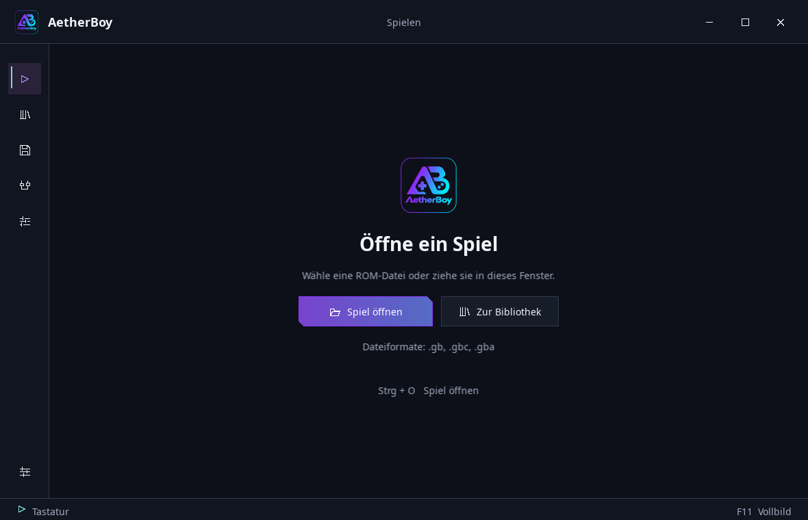
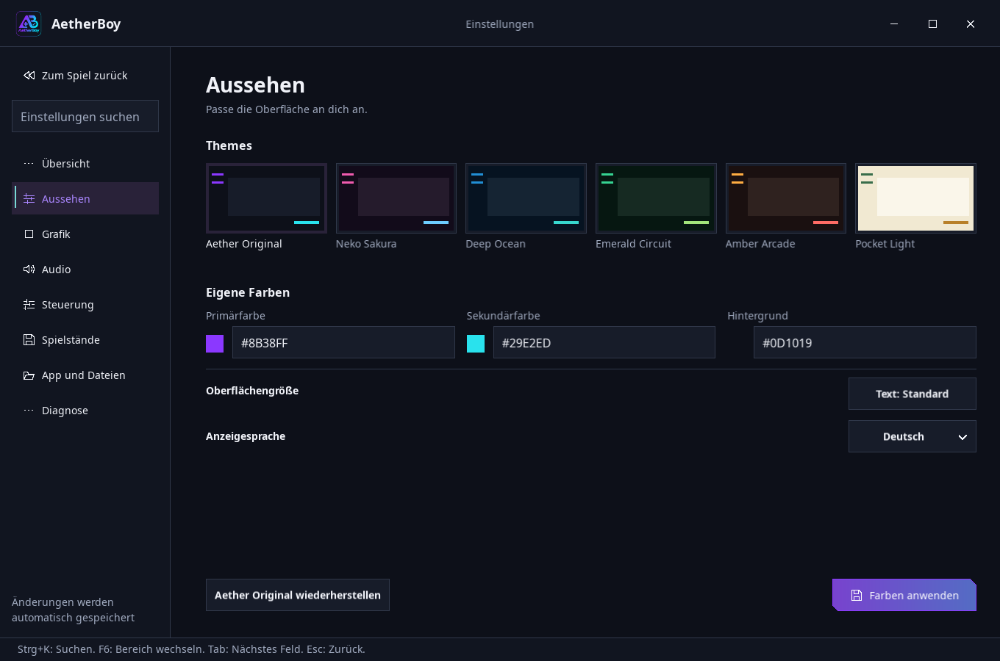
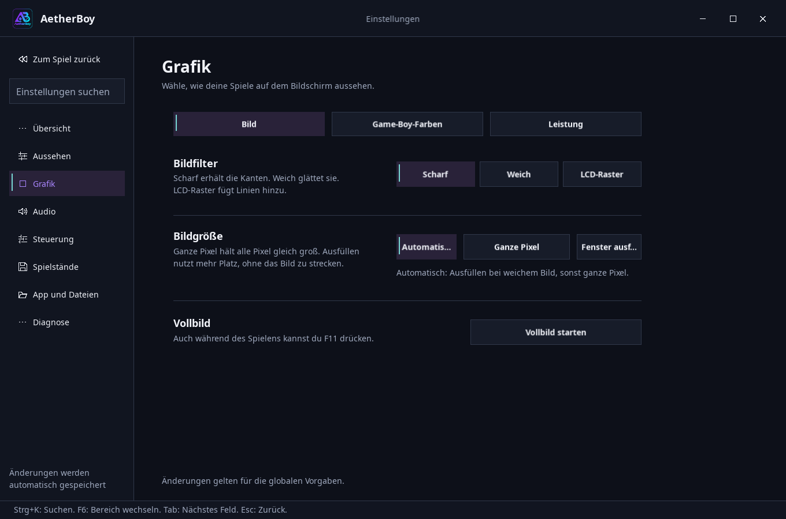

<p align="center">
  
</p>

# AetherBoy

AetherBoy ist ein quelloffener **Game-Boy- und Game-Boy-Color-Emulator mit
experimenteller Game-Boy-Advance-Unterstützung**, geschrieben in C# für Windows
und natives Linux mit Wayland. Er verbindet eine Spielebibliothek, Tastatur- und
Controllersteuerung, geschützte Spielstände, Zurückspulen und Diagnosewerkzeuge
in einer anpassbaren Desktop-Oberfläche.

[](.github/workflows/ci.yml)
[](Directory.Build.props)
[](global.json)
[](LICENSE)

[English](README.md) · **Deutsch**

[Einstieg](#einstieg) · [Tests](#entwicklung-und-tests) ·
[Dokumentation](#dokumentation-und-hilfe) · [Mitmachen](CONTRIBUTING.md)

> [!IMPORTANT]
> AetherBoy ist eine Alpha-Version. GBA und die Link-Funktionen bleiben
> experimentell. Ein erfolgreicher Start oder Verbindungsaufbau bestätigt weder
> die Spielkompatibilität noch einen erfolgreichen Pokémon-Tausch. ROMs,
> BIOS-Abbilder sowie e-Reader-Firmware und Kartendateien werden nicht mitgeliefert.

## Funktionen

- **Bibliothek und Steuerung:** `.gb`-, `.gbc`- und `.gba`-Dateien öffnen, Spiele
  aus ZIP-/7z-Archiven importieren, Favoriten verwalten und Tastatur oder Gamepad
  frei belegen. Der Sofa-Modus bietet eine controllerorientierte Bedienung.
- **Spielstandschutz:** atomare Schreibvorgänge für Batterie-Spielstände,
  Integritätsprüfungen, drei rotierende Sicherungen, fünf Save-State-Slots,
  eine State-Galerie und Zurückspulen.
- **Bild und Ton:** Skalierung mit korrektem Seitenverhältnis, die Filter Scharf,
  Weich und LCD-Raster, Game-Boy-Farbpaletten und Stereo. Screenshots, WAV-Audio
  oder AVI-Videos eines einzelnen Spiels mit Ton aufnehmen.
- **Spielwerkzeuge:** IPS-/BPS-/UPS-Patches erzeugen getrennte ROM-Dateien.
  Gemeinsame Decoder für Sitzungs-Cheats unterstützen die dokumentierten GB-/GBC-
  und GBA-Formate. Grenzen stehen in der [Cheat-Übersicht](docs/CHEAT_SUPPORT.md).
- **Anpassung:** sechs Themes, eigene Farben, Einstellungen je Spiel und
  Deutsch oder Englisch als Anzeigesprache sowie optionale Discord-Aktivität.
- **Portabler Speicher:** mit `--portable` oder der Markerdatei `aetherboy.portable`
  die Anwendungsdaten neben der ausführbaren Datei ablegen.
- **Entwicklungswerkzeuge:** Konformitätsprüfungen ohne Fenster, synthetische
  Hardware-Regressionstests, Audio- und Core-Inspektoren sowie lokale Diagnoseberichte.

Beide Oberflächen verwenden dieselbe Emulations-Runtime. Windows nutzt WinForms
mit eigenen Aether-Bedienelementen, NAudio und Direct2D; Linux nutzt SDL3 mit
nativem Wayland. Der [Plattformvergleich](docs/PLATFORM_PARITY.md) beschreibt
umgesetzte Werkzeuge und noch offene Prüfungen je Plattform.



Native Linux-/Wayland-Oberfläche aus dem aktuellen Quellstand, ohne geladenes Spiel.

<details>
<summary>Aussehen und Grafikeinstellungen ansehen</summary>





</details>

## Einstieg

### Voraussetzungen

- **Git** und **.NET SDK 10.0.302** oder ein neuerer Patch innerhalb des
  `10.0.3xx`-Featurebands. [global.json](global.json) legt das zulässige SDK fest.
  Prüfe deine Version mit `dotnet --version` im Repository-Verzeichnis.
- **Windows:** Windows 10 ab Version 2004 (Build 19041), einschließlich Windows 11.
- **Linux:** x86-64 oder ARM64, glibc **2.38+**, eine native Wayland-Sitzung und
  funktionierende Grafiktreiber. Die bereitgestellten Linux-Builds unterstützen
  weder X11/XWayland noch musl-basierte Distributionen.
- **Linux-Buildwerkzeuge:** CMake, eine C-/C++-Toolchain, Make und
  OpenSSL-Entwicklungsdateien. Das Buildskript lädt eine festgelegte Revision von
  `libdatachannel` herunter und baut sie. Unter Ubuntu 24.04 installierst du die
  Werkzeuge mit:

  ```bash
  sudo apt-get update
  sudo apt-get install cmake build-essential libssl-dev
  ```

- **Linux-Laufzeitbibliotheken:** die üblichen .NET-Abhängigkeiten einschließlich
  ICU und OpenSSL, Wayland-Clientbibliotheken sowie PipeWire, PulseAudio oder ALSA
  für die Tonausgabe. Die Dateiauswahl benötigt ein XDG Desktop Portal mit einem
  Dateiauswahl-Backend. Siehe [Wayland-Einrichtung](docs/LINUX_WAYLAND.md) und
  [Distributionsanforderungen](docs/LINUX_DISTRIBUTION.md#host-requirements-and-limits).

SDL3 und die Oberflächenressourcen werden über das Projekt bereitgestellt. Der
erste Build benötigt Internetzugriff für NuGet-Pakete und unter Linux zusätzlich
für die Quellen der nativen Abhängigkeit. Node.js 24 wird für den optionalen
Raumdienst sowie Netzwerk- und Browsertests verwendet; Python 3 für Prüf- und
Paketierungsskripte im Repository.

### Quellcode holen

```bash
git clone --branch development https://github.com/VoltexModz/AetherBoy.git
cd AetherBoy
```

Führe die folgenden Befehle aus diesem Verzeichnis aus. Die historischen
`nanoboy`-Namen für Projekt und Solution bleiben in den Buildpfaden erhalten.

### Linux-Build

```bash
bash scripts/build-linux.sh
bash scripts/run-linux.sh
```

Der Build wählt `linux-x64` oder `linux-arm64` und legt das Ergebnis unter
`artifacts/AetherBoy-<runtime>/` ab, etwa `artifacts/AetherBoy-linux-x64/`.
Zum Start wird die installierte .NET-10-Runtime benötigt; sie ist im SDK enthalten.
`run-linux.sh` baut automatisch neu, wenn die Ausgabe fehlt oder älter als die
Quelldateien ist.

Ein Spiel direkt öffnen:

```bash
bash scripts/run-linux.sh "/path/to/game.gbc"
```

Die gebaute Anwendung mit Menüeintrag für den aktuellen Benutzer installieren:

```bash
bash scripts/install-linux-user.sh
aetherboy "/path/to/game.gbc"
```

Für den Befehl `aetherboy` muss `~/.local/bin` im `PATH` liegen. Die Installation
verwendet standardmäßig `~/.local/share/aetherboy/program` und benötigt keine
Root-Rechte. Steuerung und Desktop-Einrichtung stehen im
[Linux-Benutzerhandbuch](docs/LINUX_USER_GUIDE.md).

### Windows-Build

Unter Windows in PowerShell ausführen:

```powershell
dotnet restore ./nanoboy.sln --locked-mode --configfile ./NuGet.config
dotnet build ./nanoboy.sln -c Release --no-restore
dotnet run --project ./nanoboy/nanoboy.csproj -c Release --no-build
```

Ein Spiel beim Start öffnen:

```powershell
dotnet run --project ./nanoboy/nanoboy.csproj -c Release --no-build -- "C:\Games\game.gbc"
```

### Erste Schritte

1. Wähle **Spiel öffnen** oder ziehe eine ROM ins Fenster. Bei ZIP-/7z-Archiven mit
   mehreren Spielen erscheint eine Spielauswahl.
2. Passe Tastatur, Controller und Ton in den **Einstellungen** an. Suche nach
   **Sprache**, um Deutsch, Englisch oder Systemsprache auszuwählen, und starte
   die Anwendung anschließend neu. Die Systemauswahl verwendet bei deutschen
   Systemsprachen Deutsch, sonst Englisch.
3. Speichere im Spiel für einen Batterie-Spielstand oder nutze einen Save-State-Slot
   für den genauen Emulationszustand. Save States sind an ROM, Hardwaremodell und
   gegebenenfalls BIOS gebunden; ältere inkompatible Formate werden abgewiesen.

Unter Linux gelten standardmäßig die Pfeiltasten, **Z/X** für A/B (**Y/X** auf
deutschen Tastaturen), **Enter/Backspace** für Start/Select und **Q/E** für GBA L/R.
**F5/F8** speichern beziehungsweise laden den gewählten Slot, **F7** spult zurück
und **F11** wechselt ins Vollbild. Spieltasten verwenden physische Tastenpositionen;
siehe [alle Linux-Tastenkürzel](docs/LINUX_USER_GUIDE.md#5-controls).

### Spielstände und Firmware

| Daten | Standardpfad |
| --- | --- |
| Windows-Anwendungsdaten | `%LOCALAPPDATA%\AetherBoy`, unter anderem mit `Saves`, `States` und `Settings` |
| Linux-Spiele und Spielstände | `$XDG_DATA_HOME/aetherboy`, normalerweise `~/.local/share/aetherboy` |
| Linux-Einstellungen | `$XDG_CONFIG_HOME/aetherboy`, normalerweise `~/.config/aetherboy` |
| Linux-Diagnose und Cache | `$XDG_STATE_HOME/aetherboy` und `$XDG_CACHE_HOME/aetherboy` |

Der portable Modus verwendet `AetherBoyData` neben der Anwendung. Er benötigt
einen beschreibbaren Programmordner und übernimmt vorhandene Profile nicht
automatisch. Windows und Linux verwenden unterschiedliche Ordnerstrukturen;
lies vor einem Umzug die [Anleitung zum portablen Modus](docs/PORTABLE_MODE.md).

Ohne bereitgestelltes BIOS verwendet GBA den eingebauten High-Level-BIOS-Ersatz.
Ein optionales eigenes GBA-BIOS muss genau 16 KiB groß sein. Firmware lässt sich
über die Einstellungen importieren. Die e-Reader-Kartenbibliothek benötigt
zusätzlich eigene passende e-Reader-Firmware und Kartendateien.

### Distributionspakete erstellen

Diese Skripte bündeln die .NET-Runtime, den zugehörigen Quellcode und Lizenzhinweise:

```bash
# Linux: verwendet die Hostarchitektur; benötigt Python 3.12+, GNU tar und gzip.
bash scripts/package-linux.sh
```

```powershell
# Windows x64: unter Windows ausführen.
./scripts/package-windows.ps1
```

Linux-Archive landen unter `artifacts/packages/`, Windows-Pakete unter
`artifacts/windows-packages/`. Entpacke ein Paket und starte `launch-linux.sh`
beziehungsweise `AetherBoy.exe`; alle mitgelieferten Dateien müssen zusammenbleiben.
Linux benötigt weiterhin die oben genannten Systembibliotheken und eine
Wayland-Sitzung. Prüfsummen und Paketierungsoptionen beschreibt die
[Linux-Distributionsanleitung](docs/LINUX_DISTRIBUTION.md).

## Kompatibilität und Grenzen

- **GB/GBC:** verbreitete MBC1-/MBC1M-/MBC2-/MBC3-/MBC5-Cartridges sind implementiert,
  einschließlich MBC3-Echtzeituhr. Einzelne Timing-Eigenschaften und ungewöhnliche
  Cartridge-Hardware bleiben unvollständig. [COMPATIBILITY.md](COMPATIBILITY.md)
  dokumentiert die geprüfte Konformitätsmatrix, keine allgemeine Spielkompatibilitätsquote.
- **GBA:** die Anwendung verwendet einen gepflegten Quellcode-Fork des
  MIT-lizenzierten [GBADotnet-Kerns](third_party/GBADotnet.Core/README.md).
  Timing, Sonderfälle der Bildausgabe und breitere Spieltests bleiben offen;
  siehe [GBA.md](GBA.md).
- **Local Link Lab:** zwei GB-/GBC-Spiele oder zwei GBA-Spiele laufen in einer
  lokalen Sitzung mit getrennten Spielständen. Die Kompatibilität mit
  kommerziellen Spielen ist noch nicht bestätigt. GBA kann nicht mit GB/GBC
  verbunden werden. Siehe [Local Link Lab](docs/LOCAL_LINK_LAB.md).
- **Online Link:** GB-/GBC-Verbindungen und ein begrenztes GBA-Pokémon-Gen3-Profil
  stehen für Entwicklungstests bereit. Sitzungen nutzen private Spielstandkopien;
  eine Verbindung bestätigt keinen Tausch. Allgemeiner GBA-Netzwerkmehrspieler,
  Wireless, Joybus und Vier-Spieler-Link sind nicht verfügbar. Siehe
  [GB-/GBC-Anleitung](docs/ONLINE_LINK_HANDOFF.md) und
  [GBA-Gen3-Anleitung](docs/GBA_ONLINE_HANDOFF.md).

Native Raumcodes benötigen einen eingerichteten privaten Signalisierungsdienst
und Relay-Zugangsdaten. Die manuelle WebRTC-Verbindung mit Browserunterstützung
bleibt verfügbar. Für Arbeiten an Raumverbindungen helfen die
[Raumdienst-README](services/online-rooms/README.md) und
[Verbindungsdiagnose](docs/ONLINE_CONNECTION_DIAGNOSTICS.md). Normale lokale
Emulation benötigt keinen Dienst.

## Projektstruktur

| Pfad | Aufgabe |
| --- | --- |
| [nanoboy/Core](nanoboy/Core) | Plattformneutrale GB-/GBC-Emulation, Speicherverträge und gemeinsame Grundlagen; `Advance/` enthält einen eigenständigen GBA-Prototyp. |
| [nanoboy/Runtime](nanoboy/Runtime) | Sitzungsverwaltung, Befehle und Snapshots, GBA-Anbindung, Aufnahmen, Cheats, Lokalisierung und Link-Transporte. |
| [nanoboy](nanoboy) | Windows-WinForms-Oberfläche, eigene Aether-Bedienelemente und Windows-Plattformdienste. |
| [frontends/AetherBoy.Desktop](frontends/AetherBoy.Desktop) | Linux-SDL3-/Wayland-Oberfläche und Desktop-Integration. |
| [third_party](third_party) | Eingebundener GBADotnet-Quellcode sowie Lizenz- und Herkunftsnachweise für Abhängigkeiten. |
| [tests](tests) | Tests für Core, Runtime, Linux-Oberfläche, Windows-Smoke-/UI-Tests und Browsertests. |
| [tools](tools) | Konformitätsrunner, GBA-, Verbindungs- und Leerlaufproben sowie UI-Migrationshilfen. |
| [services/online-rooms](services/online-rooms) | Optionaler privater Signalisierungsdienst mit Node.js ohne zusätzliche Paketabhängigkeiten. |
| [scripts](scripts) und [packaging](packaging) | Werkzeuge für Build, Installation, Distribution und isolierte UI-Tests. |
| [docs](docs) und [branding](branding) | Benutzer- und Entwickleranleitungen, Prüfberichte und gemeinsame Grafikressourcen. |

Eine `EmulationSession` verwaltet den veränderlichen Emulationszustand auf einem
eigenen Thread. Die Oberflächen senden typisierte Befehle und lesen Snapshots
sowie synchronisierte Bild- und Audiodaten. Plattform-APIs gehören in die
Frontend-Schicht. Der eigenständige Prototyp unter `Core/Advance` ist vom
GBADotnet-basierten GBA-Backend der Anwendung getrennt.

Abhängigkeiten stehen in den Projektdateien; die aufgelösten Versionen sind in
den eingecheckten `packages.lock.json`-Dateien festgehalten.
[Directory.Build.props](Directory.Build.props) definiert die gemeinsame Version
und Buildregeln; [THIRD_PARTY_NOTICES.md](THIRD_PARTY_NOTICES.md) dokumentiert die
Herkunft der Abhängigkeiten.

## Entwicklung und Tests

Die Tests verwenden MSTest mit **Microsoft.Testing.Platform**, ausgewählt durch
`global.json`. Verwende die unten gezeigte Form mit `--project` oder `--solution`.

Führe unter Linux die plattformneutralen Tests einzeln aus; die vollständige
Solution enthält auch reine Windows-Projekte:

```bash
dotnet test --project tests/AetherBoy.CoreTests/AetherBoy.CoreTests.csproj -c Release
dotnet test --project tests/AetherBoy.RuntimeTests/AetherBoy.RuntimeTests.csproj -c Release
dotnet test --project tests/AetherBoy.DesktopTests/AetherBoy.DesktopTests.csproj -c Release
```

Unter Windows nach dem oben beschriebenen Solution-Build:

```powershell
dotnet test --solution ./nanoboy.sln -c Release --no-build --no-restore
```

Browserbrücke und Raumdienst mit Node.js testen; `npm install` ist nicht nötig:

```bash
node --test tests/browser/WebRtcBridge.test.cjs services/online-rooms/server.test.mjs
```

Hardwareabhängige Tests müssen ausdrücklich aktiviert werden. Setze
`AETHERBOY_TEST_NATIVE_ONLINE=1`, um nach dem Bau der nativen Bibliothek die
nativen Online-Transporttests einzuschließen; diese benötigen ebenfalls Node.js.
Für isolierte Linux-UI- und Barrierefreiheitstests baust du zunächst das oben
gezeigte Desktop-Testprojekt und startest dann:

```bash
bash scripts/test-linux-headless.sh
```

Das Headless-Skript startet einen eigenen Weston-Compositor und eine separate
D-Bus-Sitzung. Es benötigt Weston, GTK3/AT-SPI, D-Bus und Python mit GI-/AT-SPI-
Anbindung; die genauen CI-Pakete stehen im [Workflow](.github/workflows/ci.yml).
Tests mit echten Audio- und Controllergeräten sowie Langzeitprüfungen bleiben
separate Abnahmen.

Entwicklungswerkzeuge ohne kommerzielle ROM ausprobieren:

```bash
dotnet run --project tools/AetherBoy.GbaProbe/AetherBoy.GbaProbe.csproj -c Release
dotnet run --project tools/AetherBoy.Conformance/AetherBoy.Conformance.csproj -c Release -- --help
dotnet run --project tools/AetherBoy.OnlineProbe/AetherBoy.OnlineProbe.csproj -c Release -- --help
```

`GbaProbe` führt erzeugten Testcode auf dem eigenständigen Prototyp aus und schreibt
`artifacts/gba-prototype.bmp`. Konformitätsläufe benötigen separat bereitgestellte
Test-ROMs; siehe das [Beispielmanifest](tools/AetherBoy.Conformance/compatibility.example.json).
Die normalen automatisierten Tests verwenden synthetische Daten. Optionale Tests
mit bereitgestellter Firmware oder Karten benötigen lokale Testdateien.

Die [CI](.github/workflows/ci.yml) umfasst Windows- und Linux-x64-/ARM64-Builds,
Wiederherstellung anhand der Lockdateien, Mindesttestzahlen, nativen Transport und
isolierte Wayland-Tests. Sie dient als Referenz für den vollständigen Prüfablauf.

## Dokumentation und Hilfe

| Anliegen | Einstieg |
| --- | --- |
| Linux-Einrichtung, Steuerung oder Starthilfe | [Benutzerhandbuch](docs/LINUX_USER_GUIDE.md) · [Wayland-/Hyprland-Einrichtung](docs/LINUX_WAYLAND.md) |
| Windows-Werkzeuge und Einstellungen | [Entwicklungs- und Bedienungsanleitung](docs/WINDOWS_DEVELOPMENT_HANDOFF.md) · [Firmware und Diagnose](docs/WINDOWS_FIRMWARE_DIAGNOSTICS.md) |
| Speicherorte und Umzug einer Installation | [Portabler Modus](docs/PORTABLE_MODE.md) |
| Kompatibilität und Cheats | [GB-/GBC-Matrix](COMPATIBILITY.md) · [GBA-Status](GBA.md) · [Cheat-Unterstützung](docs/CHEAT_SUPPORT.md) |
| Planung und jüngste Änderungen | [Windows-Roadmap](docs/WINDOWS_ROADMAP.md) · [Linux-Roadmap](docs/LINUX_ROADMAP.md) · [Änderungsprotokoll](CHANGELOG.md) |
| Architektur und Beitragsregeln | [GBA-Architektur](docs/GBA_CORE_ARCHITECTURE.md) · [Mitwirken](CONTRIBUTING.md) |

Öffne bei Fehlern oder Fragen ein [GitHub-Issue](https://github.com/VoltexModz/AetherBoy/issues).
Nenne Version oder Commit, Betriebssystem, unter Linux auch den Compositor,
Reproduktionsschritte sowie erwartetes und tatsächliches Verhalten. Prüfe
Diagnoseberichte vor dem Teilen. Hänge keine ROMs, Firmware, privaten
Raumzugangsdaten oder persönlichen Spielstände an. Datierte Übergaben beschreiben
den damals geprüften Quellstand; spätere Änderungen zeigen der aktuelle Code
und die CI.

## Wartung und Mitarbeit

**NekoZDevTeam und die AetherBoy-Mitwirkenden** pflegen das Projekt unter
[VoltexModz/AetherBoy](https://github.com/VoltexModz/AetherBoy). Fehlermeldungen,
Dokumentationsverbesserungen, reproduzierbare Kompatibilitätsbefunde und
Codebeiträge sind willkommen.

Lies vor einem Pull Request die [CONTRIBUTING.md](CONTRIBUTING.md). Sie beschreibt
den Entwicklungsablauf, erwartete Prüfungen und Regeln für Oberfläche und
Lokalisierung.

## Lizenz und Herkunft

AetherBoy entstand 2014 als **NanoBoy** von **Frédéric Meyer**, wurde als
**ChiiBoy Color** weitergeführt und wird heute unter dem Namen AetherBoy gepflegt.
Die Urheberrechtshinweise der ursprünglichen Autoren und späteren Mitwirkenden
bleiben erhalten.

Das Projekt steht unter **GPL-3.0-only**; siehe [LICENSE](LICENSE).
Drittkomponenten behalten ihre eigenen Lizenzen, darunter der MIT-lizenzierte
GBADotnet-Kern und die MPL-2.0-Adaptionen der mGBA-Cheat- und e-Reader-Funktionen.
Vollständige Herkunftsnachweise stehen in [THIRD_PARTY_NOTICES.md](THIRD_PARTY_NOTICES.md).
